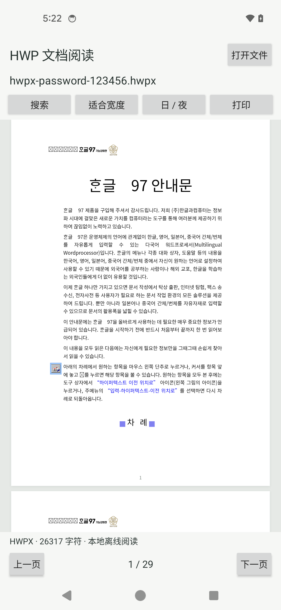

# 手机 samples 无法选择排查与密码文档实测

设备：Pixel 5，Android 14。样本位置：`/sdcard/Download/samples/`。

## 原因与处理

磁盘上的 11 份文档与项目样本 SHA-256 全部一致，没有复制损坏。系统文件选择器从“下载项目 → samples → password-hwp3”进入时却显示“没有任何项目”，尚未走到阅读器解密或转换。

改从左侧“Pixel 5 → Download → samples”进入即可看到并选择文件。对这 11 个文件调用系统 MediaProvider 的 `scan_file` 刷新索引后，已重新验证“下载项目”入口能够列出密码文档，文件保持原样。

处理范围是这批样本的系统文件索引；未修改 Android 阅读代码，也未重新安装 App。

## 实际打开结果

三个文件都经过系统文件选择器选择，在原生密码框输入 `123456`，最终出现正文和 `LOADED` 日志。

| 文件 | 显示格式 | 页数 | 阅读器字符数 | 结果 |
| --- | --- | ---: | ---: | --- |
| hwp3-password-123456.hwp | HWP 3/97 | 29 | 26,301 | 解密、WASM 转换和正文加载成功 |
| hwp5-password-123456.hwp | HWP | 100 | 56,818 | 解密和正文加载成功 |
| hwpx-password-123456.hwpx | HWPX | 29 | 26,317 | 解密和正文加载成功 |

前者从手机实际存储入口选择；后两者从刷新后的“下载项目”入口选择。本次未开启页面自动自检，也未逐页人工核对复杂版式；分发保护和图表样本仅刷新了索引，未逐一重新打开。

[逐文件哈希、扫描结果和加载结果](results.json) · [阅读器日志](reader.log)

[密码 HWP 3 实际加载截图](password-hwp3-loaded.png)
