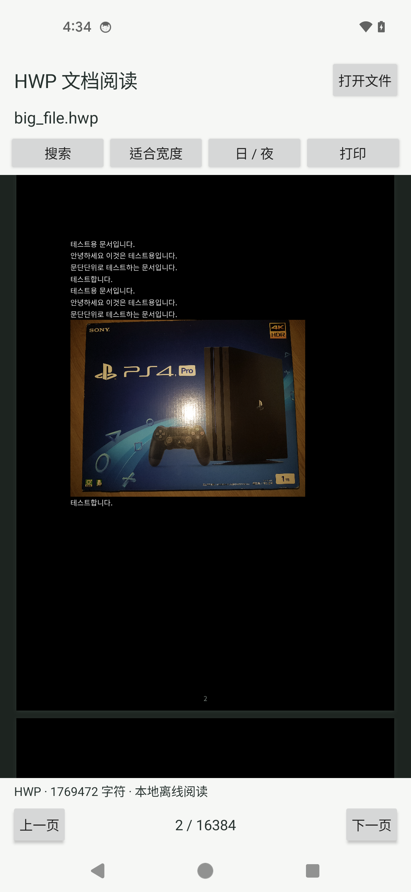

# WASM 裁剪后测试结果（2026-11-27）

本轮 Downloads 实机样本 **8/8 通过**；本地 JS／WASM 测试 **10/10 组通过**，Kotlin 会话单元测试 **5/5 通过**。

## 实机环境与方法

- Pixel 5，Android 14，实体 USB 设备。
- 安装 `app/build/outputs/apk/debug/app-debug.apk`，大小 11,687,508 字节。
- 包 SHA-256：`e316188d5b6496106a86613c9649b56d0ab403c8841f01e8f08f6ad33c831e81`。
- 安装前逐字节核对包中的 `rhwp.js`、`rhwp_bg.wasm` 与当前源码资源一致，记录见 [build-under-test.json](build-under-test.json)。
- 直接通过系统文件选择器打开手机 `/sdcard/Download/HWPTest/` 内文件，未修改原文件。每次核对页面文件名、`LOADED` 和 `SMOKE_OK`；大文件的文件名另由截图核对。
- 自检覆盖文本保留、适用时的搜索、图片解码、复制／打印策略及页面结构；大文档另覆盖按需分页挂载与末页访问。

## Downloads 实机结果

前七个文件位于 `HWPTest/testFileHWPX/reader_writer/`；大文件位于 `HWPTest/sample_hwp/`。

| 文件 | 实测内容 | 结果 |
| --- | --- | --- |
| HeaderFooter.hwpx | 页眉、页脚；正文文字核对 | 通过 |
| MultiColumn.hwpx | 3 栏、2 页；文字保留 | 通过 |
| PageSize_Margin.hwpx | 横向纸张与页边距；1031.8 × 728.52 pt | 通过 |
| SimpleEquation.hwpx | 1 个公式；文字保留 | 通过 |
| sample1.hwpx | 文字、矩形和椭圆；搜索自检 | 通过 |
| SimplePicture.hwpx | 1 张图片，1 张成功解码 | 通过 |
| SimpleTable.hwpx | 1 个表格；文字保留 | 通过 |
| big_file.hwp | 10.60 MB、1,769,472 字符；按需分页、图片解码、搜索与末页自检 | 通过 |

大文件阅读器报告 16,384 页，仅挂载 3 页；该页数来自本项目的按需分页，不代表已独立核对与 Hancom 的分页一致。手动点击“下一页”后到第 2 页，切换夜间模式后正文正常显示，进程仍存活，已采集日志未见崩溃或阅读错误。

逐文件结构化结果和本次页面日志：

- [device-results.json](device-results.json)
- [device-session.log](device-session.log)

### 实机截图

[表格截图](table-device.png) · [大文件第一页](large-device.png) · [大文件第二页和夜间模式](large-night-device.png)

## 本地测试结果

| 测试组 | 结果 |
| --- | --- |
| Worker 生命周期 | 10 项通过 |
| 密码处理 | 通过（独立 Node/OpenSSL 加密样本） |
| 分发保护 | 通过 |
| HWP 记录兼容 | 通过 |
| 阅读模型 | 通过 |
| 公式 | 通过 |
| 图表网格 | 通过 |
| 旧图表归档 | 真实图表样本通过 |
| 格式转换往返 | HWPML、内置 HWP、内置 HWPX 共 3 个输入通过 |
| 裁剪前后 WASM 对比 | 13 个输入的输出字节、提取文字和转换报告完全一致；2 个非法输入异常一致 |

本轮重新执行了以上脚本；各组命令、运行时间和结果见 [javascript-results.json](javascript-results.json)，同目录 `.log` 保留完整输出。

`ReaderSessionTest` 的 5 项测试通过 JUnit 4.13.2 **直接重新执行已有编译产物**，不是读取上次的 XML 结果。输出见 [kotlin-junit.log](kotlin-junit.log)。

## 本轮未覆盖与环境限制

- **HWP3／HWPML 本轮没有实机覆盖**，其结果来自本地原版／裁剪版 WASM 对比；不能据此宣称旧格式已在这台手机验证。尝试传入新增实机样本时，ADB 文件推送受当前执行环境的本地 Socket 限制，未成功写入。
- 手机上旧批量语料缓存已不存在；发现后改用系统文件选择器直接读取 Downloads。未将缺失缓存的预检错误计为文档回归失败，也未把旧的 94 份结果作为本次结果。
- 本轮 Gradle 构建／Lint／Gradle 单元测试在启动阶段因 `FileLockContentionHandler` 的 `java.net.SocketException: Operation not permitted` 中止，详见 [gradle.log](gradle.log)。因此本轮使用上次成功构建、且 WASM／JS 已与源码逐字节核对的 Debug 包。
- 本轮未执行打印到文件、密码文件实机流程，也未逐页人工核对全部复杂版式。
